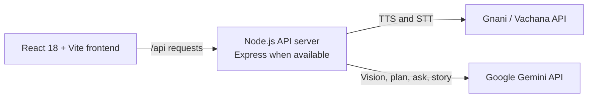

# Sarthi

> A live AI guide that sees where you are, speaks your mother tongue, and re-plans your day as it happens.

## Solution pitch

A traveler should not have to go 2,000 km to find a guide who speaks their language. Sarthi is a voice-first companion for India’s heritage sites: it helps plan the day, guides travelers through each stop, answers spoken questions in their language, and adapts what comes next as the day unfolds.

[Read the Sarthi solution pitch](sarthi-pitch-updated.pdf).

[](https://react.dev/)
[](https://vite.dev/)
[](https://vachana.ai/)
[](https://ai.google.dev/gemini-api)

Sarthi (सारथी) is a travel companion for exploring heritage sites in India. It connects trip planning with a location-aware guide, voice tools, and an itinerary that can respond to progress during the day.

## The problem and the idea

India’s heritage sites can be difficult to navigate without a guide who speaks your language. Travelers also have to decide which places fit into a day as opening hours, group needs, and fatigue affect the plan. Booking apps focus on reservations, while fixed audio guides follow a preset sequence. Sarthi brings planning and on-site guidance into one flow, then helps you choose what to do after each stop.

## Key features

- **Trip planner:** choose a destination, trip length, start time, pace, and auto or manual planning; group details affect place selection and schedule.
- **Place selection:** browse monument records with photos and select the stops for your trip.
- **Editable itinerary:** review, reorder, and move stops between days; the local scheduler estimates visits, travel, opening hours, and breaks.
- **Getting There:** enter a hotel or starting point by text or voice, use device or demo coordinates, choose walking, auto-rickshaw, or cab, and see a recalculated ETA. ETAs use coordinate-based estimates and do not include live traffic.
- **Arrival briefing:** review saved visitor guidance, hours, and photo spots before entry.
- **Photo check-in:** compare a photo with planned places using Gemini Vision when configured, or check in manually.
- **Guided walk:** follow authored landmark stops where route data is available.
- **Voice Q&A:** ask in English, Hindi, Tamil, or Bengali. The Live Guide matches authored questions; the Guided Walk can request a grounded Gemini answer from Sarthi’s authored notes.
- **What next?:** after a stop, see nearby dining, a reordered next stop, rest, skip, and end-day choices using the saved plan, time, location, hours, group details, and walking time.
- **Trip Story:** create and share a short story from visited places and check-in photos. Gemini can write the summary; a localized rules-based summary is available as a fallback, with spoken playback in the app.
- **Guide Passes:** preview per-place, day, trip, and family pass concepts. Demo unlocks are saved on this device; payments are not implemented. Monument admission tickets are separate.

## How it works

### Traveler flow

```mermaid
flowchart LR
    A[Language] --> B[Destination]
    B --> C[Days and start time]
    C --> D[Auto or manual plan]
    D --> E[Group needs and pace]
    E --> F[Select places]
    F --> G[Edit itinerary]
    G --> H[Trip overview]
    H --> I[Guide Passes]
    I --> J[Getting There]
    J --> K[Arrival briefing]
    K --> L[Photo check-in or manual check-in]
    L --> M[Guided walk and voice Q&A]
    M --> N[What next?]
    N -->|Eat, rest, or continue| J
    N -->|End day or no stops remain| O[Trip summary and return estimate]
    O --> P[Trip Story]
```



### Architecture



Provider credentials are read by the backend and sent from the server. They do not belong in frontend `VITE_` variables. The frontend talks to the backend through `/api`; the Vite development proxy target is configurable with `VITE_BACKEND_URL`.

## Where AI is used

| Feature | Model / service | What it does | Fallback when unavailable |
|---|---|---|---|
| Photo check-in | Gemini Vision (`/api/ai/vision`) | Checks a photo against the places and landmark names supplied by the itinerary. | Returns a conservative no-match result; manual check-in remains available. |
| Optional itinerary-plan API | Gemini (`/api/ai/plan`) | Arranges supplied Sarthi place IDs using the supplied trip details and opening hours. | The endpoint has a deterministic rules-based planner. The current trip-planning UI builds its itinerary with the local `planner.js`; it does not call this Gemini endpoint. |
| Guided Walk voice Q&A | Gemini (`/api/ai/ask`) | Answers from the selected place’s authored Sarthi facts and returns source labels. | A local keyword match selects an authored fact or returns an “I don’t have a reliable answer” response. |
| Live Guide voice Q&A | Gnani STT plus local authored-question matching | Transcribes the spoken question, matches it against the place’s authored Q&A, and presents an answer. | Without a Gnani key the backend returns a demo transcription. STT provider errors are shown to the user rather than silently interpreted. |
| Speech output | Gnani TTS | Generates spoken narration and answers in the selected supported language. | The backend can return mock audio without a key; the app’s audio views use browser speech when Gnani audio is unavailable. |
| Trip Story | Gemini (`/api/ai/story`) | Writes a short summary from completed place notes, the traveler’s language, and eligible check-in photos. | A localized rules-based summary is used. Browser speech is available when Gnani playback cannot be used. |

Gemini calls use server-side JSON schemas. Place-oriented endpoints are constrained to known candidates or authored facts, and AI responses include a `source` value (`gemini` or `fallback`).

## Local development

### Requirements

This repository uses npm workspaces. The commands below were run with Node.js `v26.13.0` and npm `11.20.0`.

### Install and configure

From the repository root, install dependencies and copy the example environment files on first setup. These copy commands replace an existing destination, so preserve any local `.env` files you already use.

```bash
npm install
cp .env.example .env
cp frontend/.env.example frontend/.env
```

The root `.env` is read by the backend. The frontend `.env` contains backend URL and API-prefix settings only. Keep `GNANI_API_KEY` and `GEMINI_API_KEY` on the server.

| Variable | Used by | Default | Purpose |
|---|---|---|---|
| `GNANI_API_KEY` | Backend | Empty | Gnani API key ID for TTS and STT. Without it, the backend uses its Gnani demo responses. |
| `GEMINI_API_KEY` | Backend | Empty | Enables Gemini Vision, planning endpoint, grounded Q&A, and Trip Story. The AI endpoints use their code-defined fallbacks when unavailable. |
| `GEMINI_MODEL` | Backend | `gemini-3.8-flash` | Gemini model name used by the server. |
| `PORT` | Backend | `5001` | Backend listen port. |
| `GNANI_BASE_URL` | Backend | `https://api.vachana.ai` | Gnani API base URL. |
| `CORS_ORIGIN` | Backend | `*` | Backend CORS origin setting. |
| `VITE_BACKEND_URL` | Frontend dev server | `http://localhost:5001` | Backend target for the Vite `/api` proxy. |
| `VITE_API_BASE_URL` | Frontend | `/api` | API prefix used by browser clients. |

### Start the app

Run these in separate terminals from the repository root:

```bash
npm run dev:backend
```

```bash
npm run dev:frontend
```

Open <http://localhost:3000>. The backend health endpoint is at <http://localhost:5001/api/health> when using the default port.

### Production build

```bash
npm run build
```

Vite writes the frontend build to `frontend/dist`. The build uses Rollup `manualChunks` for React and map dependencies.

## Current scope and limitations

- Authored walking routes and complete visitor guidance currently exist for Humayun’s Tomb, Red Fort, and Qutub Minar. Other places may not yet have an authored walk.
- Route directions are content suggestions and carry onsite-verification comments; confirm current visitor access and signs at each site.
- Travel and dining distances are estimates from saved coordinates. Live road traffic and turn-by-turn navigation are not connected.
- The planner used in the UI is rules-based. The separate Gemini plan endpoint is implemented but is not wired into that UI flow.
- Guide Passes are a demo entitlement concept. There is no payment processing.
- Trip setup and progress are stored in browser local storage; there is no account or cloud-sync service in this repository.

## Repository layout

```text
backend/                  Node.js API server, Gemini and Gnani services
frontend/src/views/        React planning, exploration, and travel-day screens
frontend/src/lib/          Browser API clients, itinerary planner, and next-step logic
frontend/src/data/         Monument records and language content
scripts/                  Gnani audio generation and audioSrc update utilities
```

## Verification

The following commands were run for this README: `npm install`, both development-server commands, and `npm run build`. The local frontend returned HTTP 200 and `/api/health` returned `status: ok`. At that check, Gemini was not configured, so live Gemini generation was not exercised.
